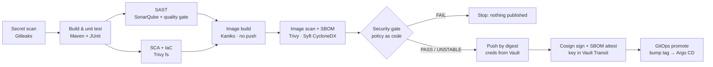

# devsecops-pipeline-template

[](https://github.com/pratheek888/devsecops-pipeline-template/actions/workflows/ci.yaml)


A **Jenkins shared library** that gives every service the same secure delivery pipeline in three lines:

```groovy
@Library('devsecops') _
devsecopsPipeline(appName: 'payments-api', registry: 'registry.example.com/team', environment: 'prod')
```

Each build scans for **secrets**, **code issues**, **vulnerable dependencies**, **IaC misconfigurations** and
**image vulnerabilities**. One **policy-driven security gate** then decides pass / unstable / fail.
Only images that pass are **pushed, signed with a key held in Vault, given an SBOM attestation** and
**deployed through GitOps**.

---

## Pipeline



| Stage | Step | Tools | Why it's built this way |
|---|---|---|---|
| Secret scan | `secretScan` | Gitleaks | Runs first, over git history, with a **redacted** report so secret values never reach logs or artifacts |
| Build & test | built-in | Maven, JUnit | Test results published to Jenkins |
| SAST | `sastScan` | SonarQube | Quality-gate result from the webhook, enforced by the gate (not by a sleep or a poll) |
| SCA + IaC | `dependencyScan` | Trivy fs | Dependencies **and** Dockerfile / K8s / Helm / Terraform misconfigurations |
| Image build | `imageBuild` | Kaniko | No Docker socket on agents. The image is built to a tarball and **not pushed** yet |
| Image scan + SBOM | `imageScan` | Trivy, Syft | OS + language packages and secrets baked into layers. CycloneDX SBOM |
| Security gate | `securityGate` | [`SecurityGate`](src/io/github/pratheek888/devsecops/SecurityGate.groovy) | One decision from every report, per-environment thresholds, time-boxed exceptions |
| Publish & sign | `imagePublish` | crane, Cosign, Vault | Registry creds from Vault KV for this step only. **Signing key never leaves Vault Transit**. Signed **by digest** |
| Deploy | `gitopsPromote` | git, yq | Deploys by committing to the GitOps repo, with a PR for protected environments. CI never gets cluster credentials |

Release-only stages (publish, deploy) run only on the release branch. Feature branches get the full scan and gate.

## Security gate: policy as code

The org defaults live in [`resources/.../default-policy.yaml`](resources/io/github/pratheek888/devsecops/default-policy.yaml).
A repo can tighten or relax them in `.security-policy.yaml`. The two are deep-merged, and exceptions add up.

```yaml
environments:
  prod:
    vulnerabilities:
      failOn: [CRITICAL, HIGH]     # fixable findings at these severities fail the build
      warnOn: [MEDIUM]             # ...these mark it UNSTABLE
    misconfigurations:
      failOn: [CRITICAL, HIGH]

exceptions:                        # risk acceptance: reason + approver + expiry are mandatory
  - id: CVE-2026-0001
    package: openssl
    reason: "Not reachable: TLS terminates at the ingress; base image fix lands in 2 weeks"
    approvedBy: security-team
    expires: 2026-12-31            # after this date it stops applying and the gate reports it
```

Rules the gate applies:
- **Secrets:** any finding fails the build (`maxFindings: 0`). The answer is to rotate, not suppress.
- **Vulnerabilities:** only **fixable** ones count by default (`ignoreUnfixed`), so teams aren't blocked by CVEs
  nobody can fix yet. They're still reported.
- **Quality gate:** SonarQube `ERROR` fails the build. A gate that never ran marks it UNSTABLE.
- **Exceptions** match by ID (plus optional package and source), and **expire automatically**.

Every run writes `reports/security-gate.md` (a readable summary, shown in the build log) and
`reports/security-gate.json` (for dashboards). Both are archived with every scanner report and the SBOM.

The same engine runs outside Jenkins:

```bash
./gradlew -q securityGate --args="--env prod --trivy image=reports/trivy-image.json --gitleaks reports/gitleaks.json"
```

This repo's own CI runs the whole flow on GitHub Actions against [`sample-app/`](sample-app): real Gitleaks, Trivy and Syft
scans, gated by the same policy engine.

## Getting started

1. **Register the library** in *Manage Jenkins → System → Global Trusted Pipeline Libraries*, with name `devsecops`
   and this repo as the source.
2. **Plugins:** Pipeline, Kubernetes, SonarQube Scanner, HashiCorp Vault, Credentials Binding, Pipeline Utility Steps, JUnit.
3. **Agent image:** CI publishes `ghcr.io/pratheek888/devsecops-tools` ([`tools/Dockerfile`](tools/Dockerfile)), with pinned
   gitleaks, trivy, syft, cosign, crane and yq. Mirror it to your registry and set `agent.toolsImage`.
4. **Vault:**
   ```bash
   vault secrets enable transit && vault write -f transit/keys/cosign type=ecdsa-p256
   vault kv put secret/ci/registry username=... password=...
   ```
   Give Jenkins' AppRole a policy with `read` on `secret/data/ci/registry` and `update` on `transit/sign/cosign`.
5. **Jenkinsfile:** see [`examples/Jenkinsfile`](examples/Jenkinsfile). It promotes into
   [gitops-eks-reference](https://github.com/pratheek888/gitops-eks-reference), where Argo CD and Argo Rollouts take over.

Verify an image anywhere downstream (e.g. in an admission policy):

```bash
cosign verify --key hashivault://cosign registry.example.com/team/payments-api@sha256:...
cosign verify-attestation --key hashivault://cosign --type cyclonedx registry.example.com/team/payments-api@sha256:...
```

### Options

| Option | Default | |
|---|---|---|
| `appName`, `registry` | required | image = `registry/appName:<git sha 8>` |
| `environment` | `dev` | selects the policy thresholds and GitOps target |
| `releaseBranch` | `main` | publish + deploy only from here |
| `buildCommand` / `testResults` | `mvn -B verify` / surefire XML | any build tool works |
| `sonar.enabled` / `sonar.projectKey` | `true` / `appName` | |
| `vault.url`, `vault.credentialId`, `vault.registrySecretPath`, `vault.cosignKey` | see `defaults()` | |
| `gitops.enabled`, `repo`, `valuesFile`, `yamlPath`, `credentialsId`, `openPullRequest` | disabled | |
| `agent.buildImage`, `agent.toolsImage`, `agent.serviceAccount` | Maven 21, tools image, `jenkins-agent` | |
| `policyFile` | `.security-policy.yaml` | |

Steps also work on their own in any pipeline: `secretScan()`, `dependencyScan()`, `securityGate(environment: 'prod')`…

## Tests

```bash
./gradlew test     # JDK 21
```

- **`SecurityGateTest`**: the policy engine against real Trivy and Gitleaks report formats, covering thresholds per
  environment, unfixed CVEs, exception matching and expiry, YAML dates, secrets and the quality gate.
- **`StepsTest`**: each `vars/` step under [JenkinsPipelineUnit](https://github.com/jenkinsci/JenkinsPipelineUnit). Checks
  that reports are redacted, the build fails or goes unstable correctly, push happens before signing, signing is by
  digest, and secrets are never interpolated by Groovy.
- **`DevsecopsPipelineTest`**: runs `examples/Jenkinsfile` end to end. Stages run in order, feature branches are never
  published, and a critical CVE or a leaked secret stops the pipeline **before** anything is pushed.
- **`test/gitops-promote-test.sh`**: the promote script against a real local Git remote (direct push, PR branch,
  idempotency, comments preserved).

Tests run on Groovy 2.4, the same version Jenkins uses for pipelines.

## Layout

```
vars/                      pipeline steps (devsecopsPipeline, secretScan, sastScan, dependencyScan,
                           imageBuild, imageScan, securityGate, imagePublish, gitopsPromote)
src/.../SecurityGate.groovy  policy engine (@NonCPS, plain data, CPS-safe)
resources/.../             default policy, gitleaks config, pod template, gitops-promote.sh
cli/                       GateCli: same gate outside Jenkins
tools/Dockerfile           pinned scanner/signing toolchain for the agent
sample-app/                tiny Java 21 service + distroless non-root Dockerfile used by CI
examples/Jenkinsfile       full configuration example
test/                      JenkinsPipelineUnit + JUnit tests, report fixtures
```

## License

MIT
